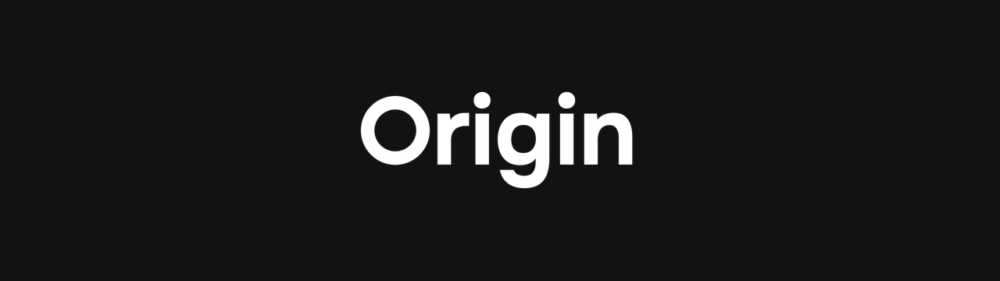
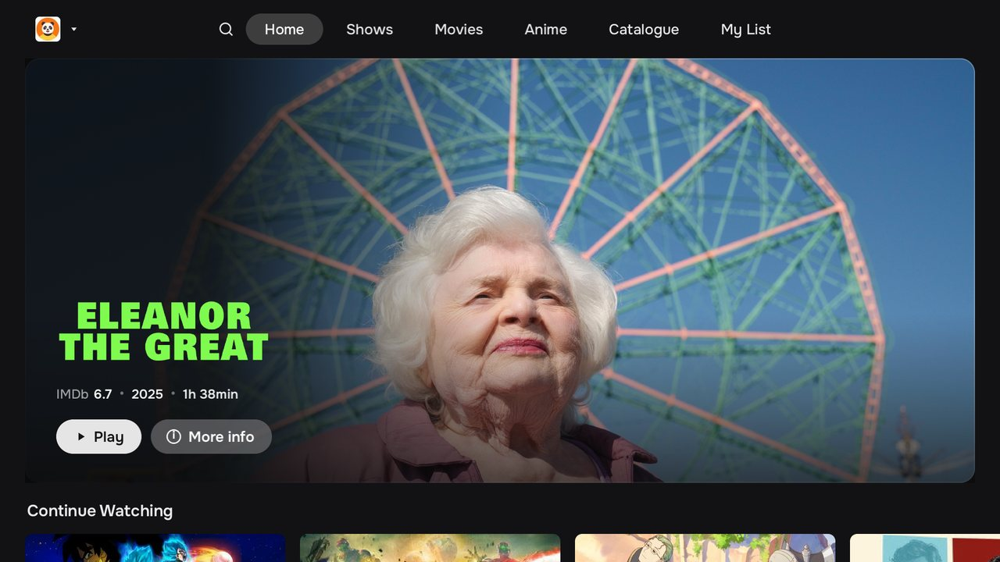
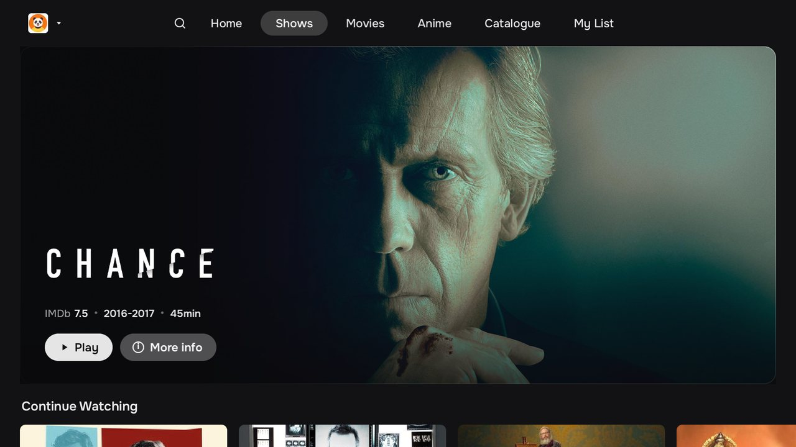
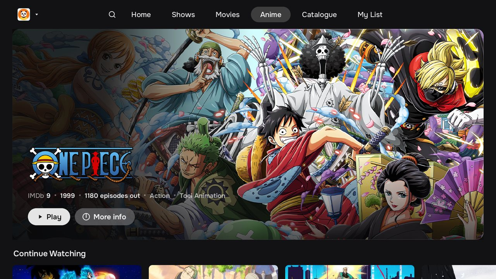
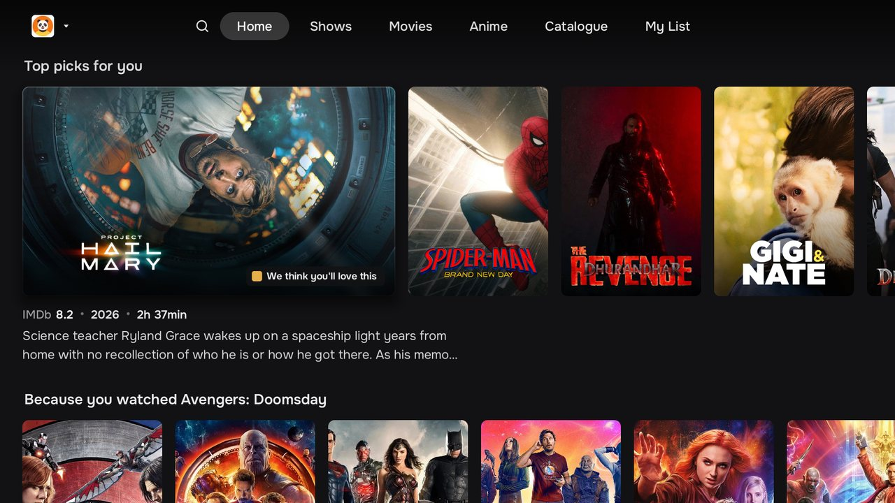
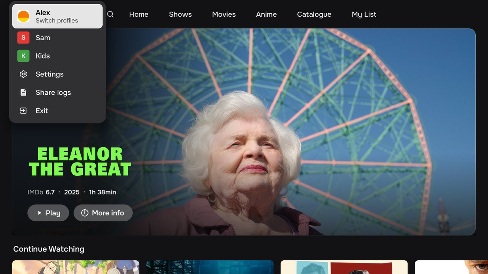
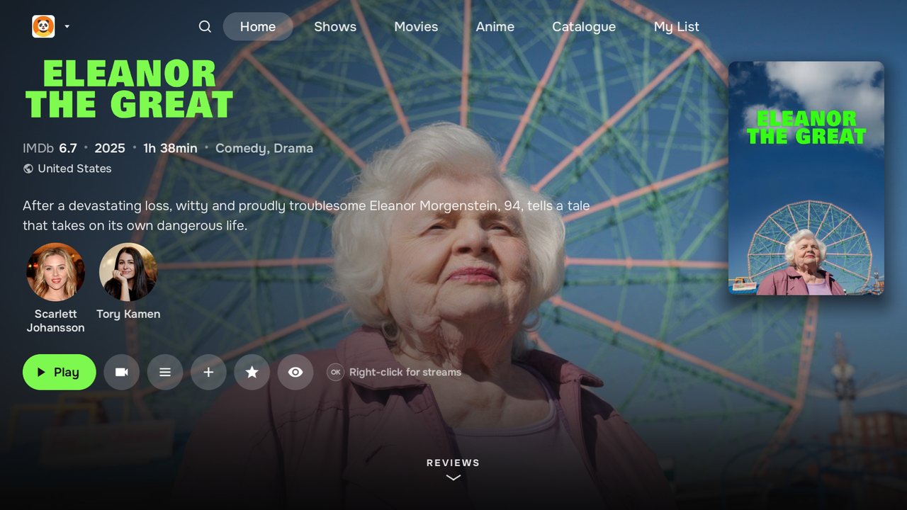
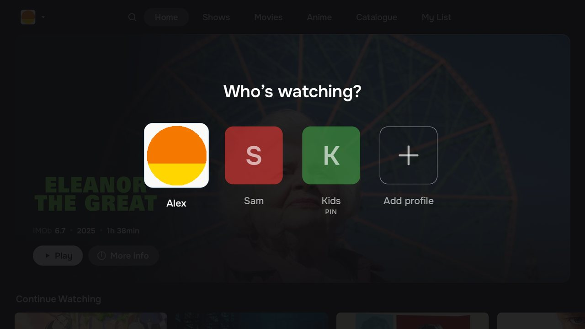
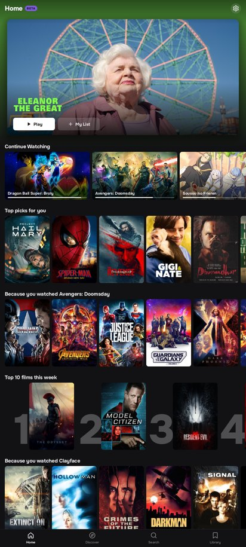

<p align="center"></p>

<p align="center">A fast, native app for your Stremio and Nuvio accounts and addons, written in C.<br>For LG webOS TVs, Android TV, Google TV, Fire TV, Android phones (beta), Windows and Samsung TVs (preview).</p>

<p align="center"><a href="https://github.com/betterstremio/origin/releases/latest"><b>Download</b></a> · <a href="https://betterstremio.github.io/">Website</a> · <a href="docs/releases/3.0.0.md">What's new in 3.0.0</a> · <a href="https://github.com/betterstremio/origin/issues">Issues</a></p>



You bring your own Stremio or Nuvio account and your own addons. The app ships empty, hosts and indexes nothing, and plays only the stream links your addons return.

<sub>Stremio™ and Nuvio are the names of their owners. This project is independent and unofficial, and is not affiliated with, endorsed by or sponsored by Stremio or Nuvio. The names only describe compatibility.</sub>

## Speed comes first
Speed is the reason Origin exists. It draws every screen itself, in C, with no browser engine inside.

- The LG package is 5.5 MB.
- On an LG C1, Home's first row of pictures is ready about half a second after Home opens.
- Posters stay compressed in memory. On the same TV, peak memory in our poster test fell from about 300 MB to about 150 MB in 3.0.0.
- Rows fetch their titles only as you get near them.

## Screens
<table>
<tr>
<td width="50%"><br><sub>Shows: a billboard, then rows picked for you</sub></td>
<td width="50%"><br><sub>Anime, with rows from AniList</sub></td>
</tr>
<tr>
<td><br><sub>Rest on a card and it opens wide</sub></td>
<td><br><sub>Switch profiles from your picture</sub></td>
</tr>
<tr>
<td><br><sub>Details, cast and reviews</sub></td>
<td><br><sub>Nuvio profiles, with PIN locks</sub></td>
</tr>
</table>

<a href="docs/brag.mp4"></a><br>
<sub>▶ <a href="docs/brag.mp4">The launch video from version 2.0.0</a>, when the app was called Better Stremio (78 s)</sub>

## Download
Get the file for your device from [the latest release](https://github.com/betterstremio/origin/releases/latest). Every name starts with `io.github.betterstremio.origin_<version>`.

| Device | File | Needs |
|---|---|---|
| LG TV | `_arm.ipk`, or install from the Homebrew Channel | webOS 3 or later |
| Android TV, Google TV, most TV boxes | `_android-arm64.apk` | Android 7.0 or later |
| Fire TV sticks, older boxes | `_android-armv7.apk` | Android 7.0 or later |
| Android phones and tablets (beta) | `_android-phone-beta.apk` | Android 7.0 or later |
| Windows PC | `_windows_setup.exe`, or `_windows_portable.zip` | Windows 10 or 11, 64-bit |
| Samsung TV (preview, not yet run on a Samsung TV) | `_tizen-beta.tpk` | Tizen 4 or later |

`_android.apk` holds both Android CPU types and works on any of them.

<details>
<summary><b>LG webOS</b></summary>

With [Homebrew Channel](https://github.com/webosbrew/webos-homebrew-channel) on the TV, add this repository in its Settings:

```
https://betterstremio.github.io/webos/apps.json
```

Origin then shows up in the Homebrew Channel's app list and installs from there, with no computer needed. New versions show up there too. Or install the `.ipk` on a TV in Developer Mode. See [Compatibility](docs/compatibility.md).
</details>

<details>
<summary><b>Android TV, Google TV and Fire TV</b></summary>

1. Download the APK. The Downloader app can fetch it from the release link and install it. On Fire TV, first turn on Settings > My Fire TV > Developer options > Install unknown apps for Downloader.
2. Android asks once to allow installs from the app you open it with.
3. Open Origin, choose Stremio or Nuvio at the top, and sign in by scanning the code with your phone, or with your email.
</details>

<details>
<summary><b>Android phones and tablets (beta)</b></summary>

Download the phone-beta APK on the phone and open it. Android asks once to allow installs from your browser or file manager. Sign in with your browser on the same phone, or with your email.

It is the same app as the TV one, with its own touch screens: rows you swipe, a card with a preview when you hold a title, and films that play sideways. Reviews, More like this and right-to-left languages are not there yet.


</details>

<details>
<summary><b>Windows</b></summary>

1. Run the setup. It installs for your user only, without an administrator prompt, to `%LOCALAPPDATA%\Programs\Origin`, and adds Origin to the Start menu. Or extract the portable zip anywhere and run `Origin.exe`.
2. The files are not code-signed, so SmartScreen says the publisher is unknown. Choose More info, then Run anyway. To check a download, compare its SHA-256 with the `.sha256` file next to it in the release.
3. Every Windows file is scanned with Microsoft Defender before it is published. If Defender still stops it on your PC, please say so in [Issues](https://github.com/betterstremio/origin/issues).

Settings and sign-in are kept in `%LOCALAPPDATA%\io.github.betterstremio.origin`. Uninstalling asks whether to remove them too.
</details>

<details>
<summary><b>Samsung TVs (preview)</b></summary>

A first Samsung build, not yet run on a Samsung TV. You install it with Apps2Samsung on a TV in Developer Mode, and install updates the same way. It builds on Stremio Origin's Samsung port, which so far works best on TVs from about 2018 to 2020. See the [Samsung guide](docs/tizen.md).
</details>

**Updates:** Settings > About shows a new version when there is one. The app downloads it and checks its SHA-256 before installing. On Windows it closes, installs the new version and opens again.

## Coming from 2.x or from Stremio Origin
From 3.0.0 the app id is `io.github.betterstremio.origin`. Origin and Stremio Origin no longer replace each other, so both can be installed on one TV.

- **Updating from 2.1.12:** the update installs the new app and opens it. On its first start it copies your sign-in, profiles and settings from the old Origin, then removes the old app and its torrent folder. Android asks you once to confirm the removal.
- **webOS on 2.1.11 or older:** the update installs 3.0.0 beside the old app. Open the new one once and it imports your data the same way.
- **Android and Windows on 2.1.11 or older:** the app updates to 2.1.12 first, then to 3.0.0. If you install 3.0.0 by hand on Android instead, sign in again.
- **Windows portable:** the old `Origin.exe` stays where it was. Delete it once 3.0.0 runs.
- Origin only imports from its own older versions. It never reads or changes Stremio Origin's data.

## What it does
**Tabs:** Search, Home, Shows, Movies, Anime, Catalogue and My List across the top, with your profile picture on the left. Anime is off until you turn it on in Settings > Appearance. Phones, and the Classic Home layout, keep Discover in place of Shows and Movies.

**For You:** about 36 rows made from what you watch: Because you watched, Top picks, your languages and genres, More with an actor, New on a service, and rows by mood. Shows and Movies get their own: Watch again, Binge-worthy and more. There is a rotating billboard, and Top 10 movies and series in your region. Continue Watching has no limit.

**Previews:** rest on a card and a short clip or trailer from IMDb plays inside it, with sound. These ask your stream addons for nothing. Previews can also play the title itself, or be turned off. [How previews work](docs/previews.md).

**Watching:** the best stream for your device and connection in one press. Episodes, sources, subtitles and audio, skip intro and recap, a next-episode card, styled subtitles and subtitle sync, HDR and Dolby Vision where your screen supports them, and P2P with a buffer sized to your device.

**Accounts and profiles:** sign in to Stremio or Nuvio with a QR code or your email, or keep both signed in and switch under Settings > Account. Each keeps its own library, addons and sign-in on the device. Nuvio profiles have their own addons, library and rows, with PIN locks, and you can add one from the picker, up to Nuvio's limit of 6.

**Everywhere:** made for a remote: the arrows, OK and Back do everything. 11 languages, including Arabic (right to left). Collections imported from your phone, in the Catalogue tab. Updates from inside the app.

**Per platform:** webOS: DTS converted on the TV, an optional USB drive for P2P, and casting from your phone. Android: DTS and TrueHD where the device decodes them or passes them to a receiver. Windows: mouse and keyboard (type on Home to search, F11 for fullscreen), a layout that fits the window, DTS and TrueHD played by the app itself, and 5.1 or 7.1 folded down to stereo for headphones without clipping.

## Set up For You
Recommendations need your own free [TMDB](https://www.themoviedb.org/settings/api) API key. If you sign in with Nuvio and saved a TMDB key there, Origin uses it. Otherwise add it under Settings > For You > TMDB key: on a TV from your phone, on Windows by copying the key and pressing OK on that row. Trakt is optional and adds ratings and reviews, with your own client id. No keys are built into the app.

## Tested on
| Platform | Tested |
|---|---|
| webOS | LG C1 (webOS 6.5) and webOS 4.4 |
| Android TV | Google TV emulator (Android 14), and the 32-bit build through Android's ARM translation. Not yet on a real TV box or Fire TV stick |
| Android phones | Emulators and one tablet |
| Windows | One PC (Windows 11, NVIDIA RTX 5080, 4K at 240 Hz) and Windows' software renderer. Not yet on Intel or AMD graphics |
| Samsung | Not run on a Samsung TV yet |

Reports are welcome, with your device and system version: [Issues](https://github.com/betterstremio/origin/issues).

## Privacy
- Sign-in goes directly to Stremio or Nuvio. Your accounts stay on the device.
- No analytics. Nothing is sent to the developer.
- Recommendations are worked out on your device. It asks TMDB about titles in your library, using your key.
- Previews from IMDb ask your addons for nothing. Only the optional "The title itself" preview asks your addons for links when you rest on a card.
- Logs stay on the device. Sharing them is your choice: the app seals them and shows a short code.

## Building
One codebase serves every platform, and everything builds in Linux or WSL. `tools/release.sh build X.Y.Z` makes every package. See [Building](docs/building.md) for each platform, the tests and the code style.

## Support
- [ko-fi.com/blueee123](https://ko-fi.com/blueee123)

## Credits
- Origin began as Better Stremio, a fork of [Stremio Origin](https://github.com/stremio-origin/webos) (GPL-3.0).
- This product uses the TMDB API but is not endorsed or certified by TMDB.
- P2P: [Nuvio Engine](https://github.com/NuvioMedia/nuvio-engine) (GPL-3.0); the app ships a modified version.
- Collections and Nuvio accounts: the collection format, how sources resolve, and the account sign-in and sync follow [NuvioTVSmart](https://github.com/NuvioMedia/NuvioTVSmart) (GPL-3.0).
- Interface sounds: [Interface Sounds](https://kenney.nl/assets/interface-sounds) by Kenney (CC0).
- The glass look: [liquid-glass-react](https://github.com/rdev/liquid-glass-react) by rdev; the app ships a modified version.
- Samsung TVs: the native backend and .NET hosts come from [Stremio Origin for Samsung](https://github.com/stremio-origin/tizen) (GPL-3.0), and the Tizen 4 to 5.5 host from [Nuvio Legacy](https://github.com/iqui27/nuvio-native-legacy) (GPL-3.0); the app ships modified versions.
- Typeface: [Onest](https://github.com/googlefonts/onest) (SIL Open Font License 1.1).
- Android video: [AndroidX Media3 / ExoPlayer](https://github.com/androidx/media) (Apache-2.0). Window and input: [SDL](https://libsdl.org) (zlib). Network: [curl](https://curl.se) with [Mbed TLS](https://github.com/Mbed-TLS/mbedtls).

## Licence
GPL-3.0, see [LICENSE](LICENSE). Third-party components and their licences: [third_party/licenses/README.txt](third_party/licenses/README.txt).
