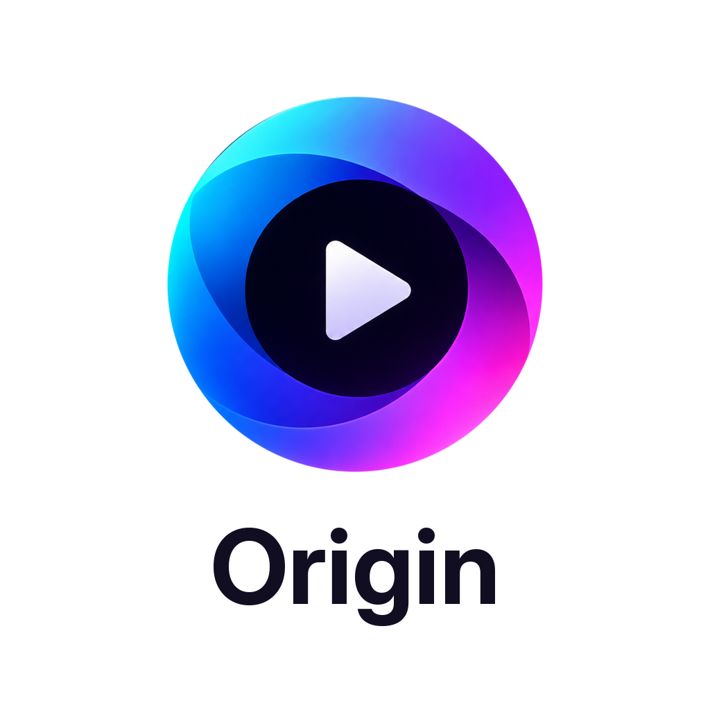

<p align="center">
  
</p>

<h1 align="center">Origin</h1>

<p align="center">A native app for your Stremio and Nuvio accounts and their addons, written in C, for LG webOS TVs, Android TV, Google TV and Fire TV.<br>Formerly Better Stremio.</p>

<p align="center"><a href="https://github.com/betterstremio/origin/releases">Releases</a> · <a href="https://betterstremio.github.io/">Website</a></p>

<p align="center"><a href="docs/brag.mp4"></a><br><a href="docs/brag.mp4">▶ Watch the video from version 2.0.0, when the app was called Better Stremio (78 s)</a></p>

<p align="center"><em>Stremio™ and Nuvio are the names of their owners. This project is independent and unofficial, and is not affiliated with, endorsed by or sponsored by Stremio or Nuvio. The names only describe compatibility.</em></p>

You bring your own Stremio or Nuvio account and your own addons. The app ships empty, hosts and indexes nothing, and plays only the stream links your addons return.

## What it does

**Stremio and Nuvio**
- Sign in to either one with a QR code or your email, or keep both signed in and switch under Settings > Account. Each keeps its own library, addons and sign-in on the device
- The top bar shows which one is in use
- Logging out of one carries on with the other
- Nuvio profiles: "Who's watching?", PIN locks, each profile with its own addons, library and For You rows. Add a profile from the picker, up to Nuvio's limit of 6

**For You, on Home**
- About 36 rows made from what you watch: Because you watched, Top picks, your languages and genres, More with an actor, New on a service, and rows by mood. Your addon rows follow them
- A rotating billboard of top picks made from what you watch, with a preview playing inside it
- Top 10 movies and series in your region
- A cinematic layout where cards open wide as you rest on them, or a Classic layout if you prefer it

**Previews**
- Rest on a card and a short clip plays, about a minute long with sound. Clips and trailers come from IMDb. A title with no clip plays its trailer. Or turn previews off
- Short clips and trailers ask your stream addons for nothing, so they work with any setup

Settings > For You > Preview on focus also offers The title itself: the film, past its opening credits, silent, for 30 seconds. **Only use it with a self-hosted AIOStreams or another provider with no public rate limit.** The app asks you to confirm before turning it on. If an addon reports that its rate limit is reached, previews use IMDb for the next 30 minutes. It asks your addons for links as soon as you pause on a card, the same request Play makes, and public instances count those requests. ElfHosted's free addons give each internet connection 100, then one more a minute, and once they run out the stream list only shows a "rate-limit exceeded" entry, so films you actually want to watch stop playing too. If you host AIOStreams yourself, set `DISABLE_RATE_LIMITS=true`, because by default it allows 10 stream requests every 15 seconds. Your debrid service has its own limits either way.

**Watching**
- The best stream for your device and connection, picked in one press
- Episodes, sources, subtitles and audio, skip intro and recap, and a next-episode card
- Styled subtitles as the film made them, and subtitle sync
- HDR and Dolby Vision where your device and screen support them
- P2P playback with a buffer sized to your device

**Browsing**
- Home, Discover, Library and Search from your addons, with artwork, logos, people and reviews
- Collections, imported from your phone, at the top of Discover
- Library, watched state and Continue Watching synced with your Stremio or Nuvio account
- Made for a remote: the arrows, OK and Back do everything
- 11 languages, including Arabic (right to left)
- Updates from inside the app

**Only on webOS:** DTS converted on the TV, an optional USB drive for P2P, and casting to the TV from your phone.

**Only on Android:** DTS and TrueHD play where the device decodes them or passes them to a receiver.

## Set up For You
Recommendations need your own free [TMDB](https://www.themoviedb.org/settings/api) API key, added in Settings > Keys. Trakt is optional and adds ratings and reviews, also with your own client id. No keys are built into the app.

Settings > For You has the rest: recommendations on or off, Home layout, region, languages, what previews play, hiding films still in cinemas, pausing history, and a refresh.

## Install

### LG webOS
For LG TVs running webOS 3 or later (ARM). See [Compatibility](docs/compatibility.md).

Download the `.ipk` from [Releases](https://github.com/betterstremio/origin/releases) and install it on a TV in Developer Mode.

### Android TV, Google TV and Fire TV
Android 7.0 or later, on ARM (64-bit or 32-bit). Phones are not supported.

1. Download `tv.stremioorigin.app_<version>_android.apk` from [Releases](https://github.com/betterstremio/origin/releases).
2. Allow installs from the app you open it with. Android asks the first time. The Downloader app can fetch the APK from the release link and install it. On Fire TV, first turn on Settings > My Fire TV > Developer options > Install unknown apps for Downloader.
3. Open the app, choose Stremio or Nuvio at the top, and sign in by scanning the code with your phone, or with your email.

### Updates
Settings > About shows a new version when there is one. The app downloads it and checks its SHA-256 before installing.

## Status
- **webOS:** tested on an LG C1 (webOS 6.5) and on webOS 4.4.
- **Android:** the automated tests pass on the Google TV emulator (Android 14), and the 32-bit ARM build through Android's ARM translation. Not yet tested on a real TV box or Fire TV stick, and For You and previews have not been tried with real addons on Android.

Reports are welcome, with your device and system version: [Issues](https://github.com/betterstremio/origin/issues).

## Privacy
- Sign-in goes directly to Stremio or Nuvio. Your accounts stay on the device.
- No analytics. Nothing is sent to the developer.
- Recommendations are worked out on your device. It asks TMDB about titles in your library, using your key.
- Resting on a card asks your addons for links to that title and the one next to it.
- Logs stay on the device. Sharing them is your choice: the app seals them and shows a short code.

## Building
One codebase serves every platform, and each package carries only its own platform's code. `src/platform/<target>/target.h` says what a package has, and `tools/targets/<target>.sh` how it is compiled. Everything builds in Linux or WSL; `tools/paths.sh` says where the toolchains, keys and build folders are.

```
tools/build.sh desktop                         # a development build for Linux, WSL or a Mac
tools/build.sh webos                           # the webOS app (needs the webOS toolchain)
packaging/webos/pack.sh                        # the webOS IPK

tools/android/build-deps.sh                    # Android: SDL2, Mbed TLS, curl for each ABI
tools/build-engine.sh android-arm64-v8a        # the P2P engine (also android-armeabi-v7a, android-x86)
tools/android/build-apk.sh                     # the release APKs: one per CPU type, and one with both
tools/android/build-apk.sh --dev               # a test build with x86 for the emulator

tools/release.sh build X.Y.Z                   # every package from empty folders, into dist/X.Y.Z
```

Android tests on the emulator: `python tools/android/test/run.py --build` (after `tools/android/test/media.sh`). The script's header says what it needs.

## Support
- [ko-fi.com/blueee123](https://ko-fi.com/blueee123)

## Credits
- This project began as a fork of [Stremio Origin](https://github.com/stremio-origin/webos) (GPL-3.0).
- This product uses the TMDB API but is not endorsed or certified by TMDB.
- P2P: [Nuvio Engine](https://github.com/NuvioMedia/nuvio-engine) (GPL-3.0); the app ships a modified version.
- Collections and Nuvio accounts: the collection format, how sources resolve, and the account sign-in and sync follow [NuvioTVSmart](https://github.com/NuvioMedia/NuvioTVSmart) (GPL-3.0).
- Interface sounds: [Interface Sounds](https://kenney.nl/assets/interface-sounds) by Kenney (CC0).
- The glass look: [liquid-glass-react](https://github.com/rdev/liquid-glass-react) by rdev; the app ships a modified version.
- Android video: [AndroidX Media3 / ExoPlayer](https://github.com/androidx/media) (Apache-2.0). Window and input: [SDL](https://libsdl.org) (zlib). Network: [curl](https://curl.se) with [Mbed TLS](https://github.com/Mbed-TLS/mbedtls).

## Licence
GPL-3.0, see [LICENSE](LICENSE). Third-party components and their licences: [third_party/licenses/README.txt](third_party/licenses/README.txt).
